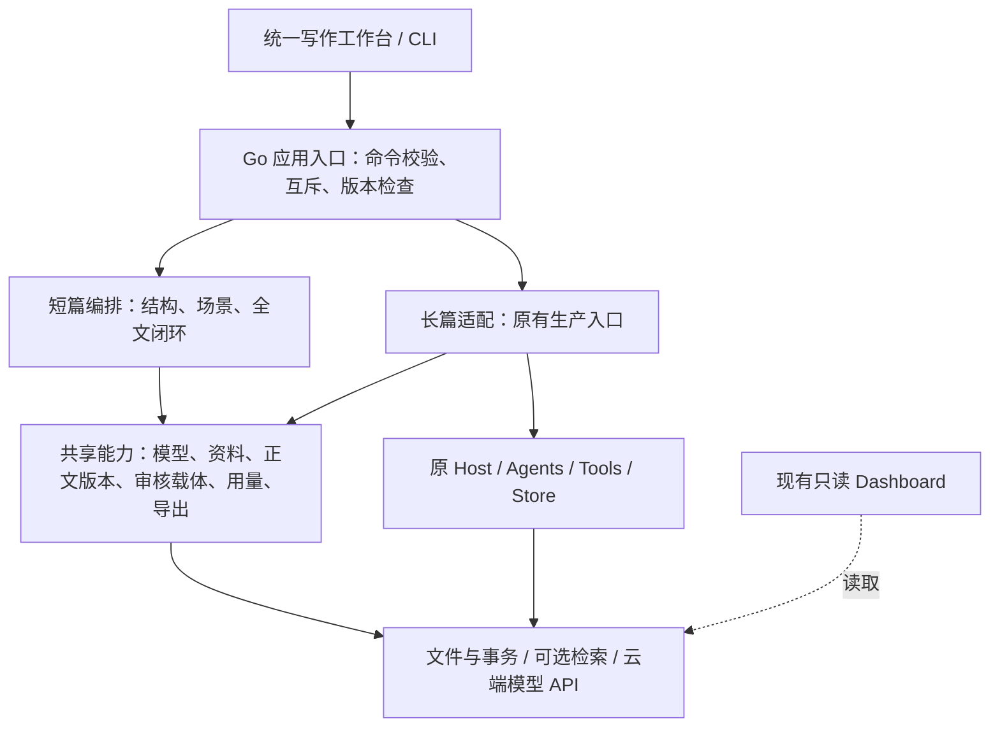

# 长短篇双管线开发计划

更新日期：2026-10-31。状态：开发计划；业务功能尚未实施，现有能力只完成下述静态核查。

开发仓库：[JueJuez/novel-studio](https://github.com/JueJuez/novel-studio)，SSH：`git@github.com:JueJuez/novel-studio.git`。

基线提交：`ed04a106f665f456246af3c4414ba62992a2a1d1`。本文件是双管线改造的任务与验收真源；实现时在本文件更新状态与证据，不另建重复的进度表。

## 1. 已确定的方向与本次交付

需求来自作者在前序讨论及本次请求中的选择：协作创作、题材不限、同时支持短篇与长篇、使用云端模型 API；以现有 Novel Studio 为底座，选择性移植 Show Me The Story / Pagekin 的能力，共性抽象、业务流程分开。

采用一个仓库、一个产品入口、两条独立业务管线。保留现有长篇生产能力，新增以结构和场景为核心的短篇流程；统一作品管理、模型配置、编辑、版本、用量和交付入口。

本次交付是开发计划、README 导航与本地 `origin` 地址调整，不代表引擎开发、模型验证、作品质量验收或发布已经完成。前序助手给出的目录、接口、功能成熟度和技术选型都只是参考，以下以本地源码和公开一手资料为依据。

## 2. 当前基础与真实缺口

| 项目现状 | 已检查的依据 | 对本计划的影响 |
|---|---|---|
| Go CLI 已有可恢复的阶段编排，默认链含初始化、整弧预演、角色推演、封存和逐章渲染 | [pipeline_cmd.go](../cmd/novel-studio/pipeline_cmd.go) | 长篇继续走现有入口；短篇新增独立编排，不借用长篇 Coordinator 再关闭几个步骤 |
| 已有短篇全文终审及交付门禁 | [pipeline_finalize.go](../cmd/novel-studio/pipeline_finalize.go)、[chapter.go](../internal/domain/chapter.go) | 复用可独立的正文合并、哈希和报告能力；不能把新短篇伪装成旧 sealed generation 来通过门禁 |
| 显式 `planning_tier=short` 必须终审；无该字段的旧项目另有 layered/实际字数兜底规则，阈值为 30,000 rune | [chapter.go](../internal/domain/chapter.go) | 新管线类型独立记录；字数和旧 planning tier 都不能作为新管线类型的隐式推断规则 |
| 长篇已有 `complete-book`，按完整章节与故事弧证据合并收口 | [pipeline_complete_book.go](../cmd/novel-studio/pipeline_complete_book.go) | 保留长篇交付口径；不把机械合并标为全文模型终审 |
| 已有 CLI 共创规划，主要产出创作指令并进入原流水线 | [cocreate_cmd.go](../cmd/novel-studio/cocreate_cmd.go) | 能复用创意澄清；仍需贯穿规划、正文、修改和交付的作者确认 |
| 已有草稿定点编辑工具，限制终稿直改，完成章节需进入返工队列 | [edit_chapter.go](../internal/tools/edit_chapter.go) | 不另写直接覆盖正式章节的编辑路径；补可视差异、候选版本和人工接受 |
| 存储主要为本地文件，已有正文事务、执行锁、checkpoint、用量和成本来源区分 | [store.go](../internal/store/store.go)、[chapter_render_transaction.go](../internal/store/chapter_render_transaction.go)、[token_cost.go](../internal/models/token_cost.go) | 优先沿用文件存储与现有基础设施，不为统一界面另建第二份正文数据库 |
| Dashboard 是 Python 只读服务，Go 负责嵌入资源和服务管理 | [server.py](../services/dashboard/server.py)、[service_cmd.go](../cmd/novel-studio/service_cmd.go) | 新增写作工作台和受控写入 API，保持观察层不直接推进状态 |
| 原生运行目标为 Linux/macOS；Windows 使用 WSL2，存储锁有 `syscall.Flock` 依赖 | [README](../README.md)、[pipeline_execution.go](../internal/store/pipeline_execution.go) | MVP 在 WSL2/Linux 验证；Windows 原生锁适配另列后续任务 |

现有文档部分为历史快照，静态查看不证明运行可用。尤其不能把已有短篇终审等同于已经存在独立轻量短篇引擎，也不能把模型 `accept` 当成作者认可。

## 3. 外部项目的使用方式

核查日期为 2026-10-31，范围为公开 README、许可证、Show Me The Story 架构说明及下列源码；尚未完整克隆审计或运行外部应用。下表列的是移植候选，不是已经验证可直接使用的模块。

| 来源 | 一手证据与候选能力 | 处理方式 |
|---|---|---|
| [Novel Studio 上游](https://github.com/Xiaoyangy/novel-studio) | 本地引擎、审核、状态和恢复；本仓库 [LICENSE](../LICENSE) 为 Apache-2.0 | 作为主底座，保留上游来源与许可证；不另建小说引擎 |
| [Show Me The Story](https://github.com/Nigh/show-me-the-story) | [README](https://github.com/Nigh/show-me-the-story/blob/main/README.md) 列出章节生成、局部编辑、事实来源、伏笔和终稿校订；[API 源码](https://github.com/Nigh/show-me-the-story/blob/main/internal/httpapi/web.go) 有块编辑及校订端点 | 首要移植候选；只吸收相关逻辑、交互和提示词，不引入整套项目状态与模型客户端 |
| Show Me The Story 的轻量检索 | [knowledge_retrieval.go](https://github.com/Nigh/show-me-the-story/blob/main/internal/story/knowledge_retrieval.go) 含本地 BM25、CJK bigram 和上下文预算处理 | 评估后适配现有检索入口；短篇默认不要求 embedding/Qdrant，不替换长篇既有 RAG |
| [Pagekin](https://github.com/EthanYoQ/AI-Novel-Writer) | [README](https://github.com/EthanYoQ/AI-Novel-Writer/blob/master/README.md) 展示选区修改、修稿差异、逐段接受、版本与文风分析等交互 | 作为功能和交互参考，在本项目实现；不引入其桌面应用与整套数据层 |

两个外部项目都包含长篇能力，不能依据产品名称将它们称为专门的短篇引擎。短篇的结构/场景状态机需要在本项目内实现。

Show Me The Story 的 [MIT 许可证](https://github.com/Nigh/show-me-the-story/blob/main/LICENSE) 要求在复制或实质复用时保留相应版权和许可文本。Pagekin 的 [许可证](https://github.com/EthanYoQ/AI-Novel-Writer/blob/master/LICENSE) 为 GPL v3 文本，本方案选择独立实现相关交互。该选择不代表禁止采用 GPL 方案；如以后决定复制其代码或资产，先单独调整许可和分发方案。

P0 对每个实际移植项记录：仓库、固定 commit、源路径、原许可证/第三方依赖、移植位置、保留/改写部分、验收案例。提示词、样例、图片和前端组件也要检查来源，不因根目录存在 MIT 就假定所有依赖同许可。实际引入后再增加 `THIRD_PARTY_NOTICES.md`，本次不建立空声明。

## 4. 产品范围与 MVP

MVP 面向单作者、本地运行、浏览器协作写作，不预设题材。创作管线由作者在创建作品时明确选择，不按字数静默切换。

短篇以约 5,000—30,000 字为首批验证范围，允许单篇无章号与多章/多场景两种组织。这个区间是验证预算，不是产品的普适文学分类；字数计算沿用项目 rune 口径，并在界面说明。长篇继续使用卷、弧、章和现有生产协议，首轮只验证一个小型多弧项目及历史恢复样本，不宣称已验证百万字规模。

MVP 必须包含：

1. 一个作品列表、统一模型配置、明确的长短篇入口和运行/失败状态。
2. 短篇完整闭环：创意澄清 → 作者确认故事结构 → 场景计划 → 草稿 → 局部修改与审核 → 作者确认终稿 → 导出。
3. 段落手改、AI 定向修改、原文/候选差异、接受/拒绝、版本恢复；拒绝候选不改变当前正文。
4. 人物、设定、已确认事实和伏笔可查看来源；未来规划、候选事实与已发生事实分开。
5. 长篇从统一入口创建、恢复、查看和协作确认；继续调用原引擎，保留 sealed、exact-body review、事务和弧验收。
6. 作者确认与模型审核分别记录；自动审核通过后仍能停在待作者确认。
7. 分阶段 token、费用来源、耗时、失败尝试及中断恢复；Markdown/TXT 导出与本地备份。

后续再做：抽象文风分析、更多导入格式、EPUB/DOCX、短转长/支线转短的复制式向导、跨作品素材库、多用户与云同步、Windows 原生安装包。MVP 不引入新的多代理框架、数据库服务、消息队列、Electron 包装或专用向量数据库作为必选依赖。

## 5. 架构与模块边界

技术方案：保留 Go 引擎、现有 provider/agentcore、本地文件及可选 RAG；新工作台采用 Svelte + Vite，借鉴 Show Me The Story 的 Web 交付方式，静态资源随 Go 二进制嵌入。具体前端依赖版本与可移植组件在 P0 固定，不机械复制其旧版本锁文件。新工作台是两个管线的统一操作入口，原 Dashboard 保留为生产监控。



共用的是基础能力与调用合同，独立的是规划、上下文组装、审核策略、阶段迁移和交付前置条件。短篇不得启动 `project-all`、角色 Agent 或 World Arbiter 以满足隐含前置；长篇不得绕过原审核与正史发布。

| 边界 | 复用基础 | 管线独有部分 |
|---|---|---|
| 模型与提示词 | `internal/bootstrap`、`internal/models`、现有 provider 与 usage 记录；提示词沿用 `assets` 管理 | 短篇的场景指令、长篇的冻结 packet 与角色可见性分别构造 |
| 人物/世界/事实 | 统一资料读取视图、来源引用、作者规则优先级 | 长篇运行态/知识边界继续由原 Store 管理；短篇维护场景级事实和结局义务 |
| 正文/版本/编辑 | 文本快照、版本哈希、差异、局部候选、确认记录 | 长篇接受修改仍走返工与重审；短篇按受影响场景/全文复审 |
| 审核 | issue 结构、正文哈希绑定、证据定位和报告展示 | 短篇检查全文冲突/结局/伏笔；长篇检查章合同、连续性、角色与故事弧 |
| 检索 | 请求接口、来源与预算统计 | 短篇可用直接上下文或本地检索；长篇保留既有 RAG 生命周期与隔离 |
| 交付 | 已确认版本读取、文件编码、清单与快照 | 新短篇的全文审核合同、原长篇的 complete-book 合同独立 |

拟新增位置（名称为规划，当前尚不存在）：

| 位置 | 职责 |
|---|---|
| `internal/project/` | 作品 ID、管线声明、旧项目只读发现与兼容映射 |
| `internal/shortstory/` | 短篇领域数据、阶段路由、场景规划、写作和全文审核 |
| `internal/authoring/` | 实际存在双管线消费者后抽取的版本、候选、作者确认和来源视图 |
| `internal/workbench/` | Web API、应用命令入口、事件投影；通过已有层的授权入口写入，不直接改产物文件 |
| `services/workbench/` | Svelte 源码、构建与嵌入资源；与只读 Dashboard 分开 |
| `assets/prompts/shortstory/` | 短篇模板，与长篇模板分别管理 |
| `cmd/novel-studio/` | 新工作台/短篇入口与长篇装配，沿用现有启动配置 |

不搬迁现有 `internal/host`、`agents`、`tools`、`store`，不把所有包都放进新建的 `shared/`。先直接复用已独立的基础包；短篇跑通后，只抽取两条管线实际重复的能力。保留现有依赖方向，禁止共享包反向引用短篇/长篇编排；不增加通用 WorkflowInstance/TaskInstance 系统。

## 6. 状态、数据与协作合同

### 6.1 短篇流程

```text
brief → structure → scenes → draft → review → author_approval → finalize → delivered
                       ↑        ↔ revise
```

上述为拟定阶段。每阶段持久化产物、状态与 checkpoint；`waiting_author`、`failed`、`cancelled` 是运行状态，不能冒充正文阶段完成。

- 结构中记录核心冲突、人物欲望与选择、结局方向、必须兑现的承诺及作者约束；故事结构模板可选，不强制三幕式。
- 场景记录 POV、目标、阻力、转折、因果依赖、发生/揭示的事实、字数预算和前后承接。场景可归属章节，也可组成一篇正文。
- 生成候选不自动成为正式故事。模型提取的事实先绑定候选版本；作者接受后才进入已确认资料。
- 作者可在结构、场景计划、正文/修稿和最终交付处确认；自动继续仅执行当前已授权范围，不跨越下一作者确认点。
- 结局允许开放式；检查的是作者选定的兑现义务和刻意保留项，不能把所有未解释内容都判为漏洞。

### 6.2 长篇接入

原默认阶段、generation、seal、promotion、正文事务和回执保持兼容。新作品的 `collaborative` 策略在初始化产物确认、封存前计划确认、正文发布前和最终交付前增加可持久恢复的作者确认边界。

确认必须进入生产权威路径：在写工具/发布事务执行正式变更前验证授权，不能只靠工作台隐藏按钮。具体 Hook 在 P0/P1 沿 [pipeline_chapter_render_transaction.go](../cmd/novel-studio/pipeline_chapter_render_transaction.go)、[pipeline_render_candidate.go](../cmd/novel-studio/pipeline_render_candidate.go) 及原 Tools/Store 调用链定位；作者等待期间释放执行租约，恢复时重新验证版本，不持锁等待人工。

旧项目默认维持原运行策略；可只读查看，不自动新增审批点或改写 generation。需要接入协作时，只能在空闲且明确的阶段边界显式启用，保存旧策略和回退点。已验收章节的故事性修改仍走原 rebase/返工边界，不提供绕过机制的“直接保存终稿”。

### 6.3 最小数据增量

在作品根目录拟增加版本化 `project.json`，至少包含 `schema_version`、稳定 `project_id`、标题、语言、`pipeline_kind`、协作策略和引擎协议标识。新作品选择 `short` 或 `long`；无 manifest 的旧作品由兼容探测器读取现有协议，不能仅凭旧 `planning_tier=short` 就按新短篇加载。

拟定新增产物：`short/` 保存短篇状态与结构/场景工件，`authoring/` 保存候选、版本与确认记录。现有长篇 `output/novel/`、`meta/`、chapters 和 checkpoint 路径保持原位。共享服务从权威 Store 投影读取，不另存一份可写的“共享正史”。

关键约束：

1. **版本匹配。** 修改请求绑定作品 ID、场景/章节 ID、稳定块 ID、来源版本和正文哈希。段落漂移、选区不唯一、旧浏览器页面都返回明确冲突，不静默退化成整章改写。
2. **候选与确认匹配。** 作者确认绑定候选哈希、父版本、规则/计划摘要。正文或硬合同变化后旧确认失效；`model_accepted` 与 `author_approved` 独立记录。
3. **来源匹配。** 事实、伏笔与审核意见绑定版本和原文位置；修改后标记陈旧，按影响刷新。候选稿、作者计划和已发生故事不得混为同类事实。
4. **修改影响。** 接受修稿生成新版本，明确列出失效的事实、摘要、审核与交付。短篇重新进行必要全文检查；长篇调用已有失效/重建路径，不私自改后续封存合同。
5. **幂等与恢复。** 同一次提交重试不重复接受候选、推进状态或发布；写入由项目级互斥、原子文件与 checkpoint 保护。跨进程也需使用同一执行边界。
6. **取消和失败。** 已有正文、候选、诊断和用量保留；半截流式输出只作恢复候选，不能自动作为有效 JSON、已确认正文或交付成果。
7. **权限范围。** 本地工作台默认绑定回环地址；写请求验证来源/会话及项目路径，拒绝目录逃逸。模型密钥保留在现有配置体系，不随作品导出。

短长篇互转延后。将来通过复制作品、提取资料、重新初始化实现，不能直接切换 manifest 或复用另一管线 checkpoint。

## 7. 分阶段实施任务

估算假设：一名熟悉 Go/Web 的开发者配合 AI，范围保持上述 MVP，云端 API 可用、作者能及时参与样稿确认。下列为开发工作日估算，不是交付日期或模型质量承诺；P0 后重新估算。

| 阶段 | 工作量估算 | 阶段交付与退出条件 |
|---|---:|---|
| P0 基线与移植审计 | 2—3 天 | 可运行基线、固定外部来源、明确可复用模块及长篇人工确认位置 |
| P1 作品入口与兼容边界 | 3—4 天 | 管线选择、旧项目发现、独立短篇骨架、候选/确认协议和最小命令入口 |
| P2 短篇闭环 | 6—9 天 | 无长篇推演依赖的短篇端到端流程，CLI/API 可操作 |
| P3 协作编辑与共享抽取 | 4—6 天 | 原文/候选比较、版本冲突保护、事实来源、逐步接入长篇共用能力 |
| P4 统一工作台与长篇协作 | 4—6 天 | 同一 UI 操作两条管线，长篇作者确认实际阻断权威写入 |
| P5 回归与真实样稿验收 | 3—5 天 | 兼容、恢复、浏览器流程、样稿和成本报告，明确未验收项 |

合计约 22—33 个开发工作日；含集成和作者评审缓冲，可按约 6—8 周安排。长篇历史协议差异、许可/依赖问题或编辑后重规划可能增加时间。先交付短篇纵向闭环，再扩充交互和抽象，避免先做完整平台框架。

### P0：先建立证据基线

| ID | 任务 / 交付物 | 验证与依赖 | 状态 |
|---|---|---|---|
| P0-01 | 在 WSL2/Linux 从固定提交构建，记录环境、依赖与现有检查结果；原始长篇/短篇样本复制后回放 | 原 CI 与 README 检查；失败区分基线问题和新回归，原件不修改。已完成（2026-10-31）：WSL2 Ubuntu 24.04 + Go 1.27.1（与 CI 同版）在 d247387 构建测试，代码树与基线 ed04a10 一致（diff 仅文档，已核实）。go build、release 构建、--version/doctor 冒烟、litellm -race、dashboard node 测试、race 分片合同、store 0/2 与 agents 0/4 分片、race-sensitive 包全部通过；go test ./... 仅 1 失败＝TestCheckpointStore_SeqNotConsumedOnWriteFailure（root 可写只读文件所致，普通用户 o1830 复测通过，非基线缺陷）；dashboard Python 52/53，1 项为 WSL2 ctime 粒度时序敏感 flake（CI 通过）。无原始作品样本工程（data/ 不存在，evals/cases 为评测断言 JSON、eval inspect 需既有产物），样本回放移交 P5-02 与验收真实样稿。日志 refer/p0-baseline-logs/（不入库）。环境注记：proxy.golang.org 不可达，需 GOPROXY=goproxy.cn | 已完成 2026-10-31 |
| P0-02 | 固定 Show Me The Story 与 Pagekin commit，审计局部编辑、来源引用、校订、组件和许可依赖 | 给每项候选填写第 3 节要求的移植记录；不以 README 声明代替源码和运行验证。已完成（2026-10-31）：两仓库完整克隆并固定于 refer/（SMTS @ f790187，Pagekin/AI-Novel-Writer @ 59153ce）；SMTS=MIT、Pagekin=GPL v3。逐项移植记录见 docs/dual-pipeline-porting-audit.md：R1 块级编辑与按块校订合同、R2 本地 BM25+CJK bigram 检索、R3 校订流程、R4 前端依赖（@xianii/design-system 许可未核查，引入前必查）；Pagekin 仅行为参考（修稿交互独立实现，文风分析登记不移植）。本轮为静态源码审计，未运行外部应用 | 已完成 2026-10-31 |
| P0-03 | 沿真实发布链定位作者确认 Hook、取消边界和 long adapter；确认既有存储哪些能无损复用 | 使用隔离 fixture 验证“模型通过但未获作者确认”时不会成为正史。已完成（2026-10-31）：定位见 docs/design-audits/author-confirmation-hook-audit-20261031.md——阶段机 body_ready→…→published 固定单调且不可跳步，模型裁决（formal_accepted）与正史晋升（published，经 DirectoryPublishStore 原子晋升）之间已隔强制 actual_matched；主 Hook＝domain 转移表 + cmd 晋升函数两道闸；取消边界＝每阶段持久回执＋既有恢复路径，作者等待不持锁；ChapterRenderTransactionStore/DirectoryPublishStore/执行锁/checkpoint 可无损复用。fixture＝internal/store/chapter_render_transaction_author_boundary_test.go（模型 accept 后跳步被拒、无发布回执、canonical 输出零字节），连同 9 个既有 chapter-render store 测试在 WSL2 Go 1.27.1 全部通过 | 已完成 2026-10-31 |
| P0-04 | 核对本 fork 的 CI、发布配置、安装器、镜像和帮助链接 | `origin` 已改不代表发行已迁移；当前安装器/Release/镜像仍有上游地址，正式发布前逐项处理。已完成（2026-10-31）：13 项逐条核对见 docs/design-audits/fork-release-audit-20261031.md；首次发布最小必改集＝.goreleaser owner + release.yml ghcr 命名空间 + main.go:377 自更新 Repo（行为级风险：fork 执行 `update` 会装回上游二进制）；install.sh/docker-compose 待首个 Release 后切换；README 徽章与 README-TECHNICAL 5 处引用随 P5-04；ci.yml/Dockerfile 无需改动；go.mod module 路径按计划 §9 保留 | 已完成 2026-10-31 |

### P1：建立入口，保护原协议

| ID | 任务 / 交付物 | 验证与依赖 | 状态 |
|---|---|---|---|
| P1-01 | 实现版本化项目 manifest、短长篇显式选择、旧项目只读发现与路径映射 | P0；无 manifest 的旧工程不写回、不重分管线，未知格式明确拒绝写入。已完成（2026-10-31）：internal/project——project.json（schema_version=novel-studio-project.v1、proj-<32hex> 稳定 ID、标题/语言/pipeline_kind/协作策略/引擎协议）；创建时显式选 short/long（无默认、不可覆盖、旧工程拒绝写回）；Load/Discover 对未知 schema_version 与未知字段明确拒绝；DiscoverRun/DiscoverRuns 与 cmd 层 resolveNovelDir 同口径只读发现；路径映射 long=output/novel 原位、short=<root>/short。测试 6 项见 internal/project/manifest_test.go；CLI 冒烟（init/status/resume、legacy 拒绝）通过 | 已完成 2026-10-31 |
| P1-02 | 增加短篇独立状态/工件与恢复入口；长篇入口仍使用原调度 | 两管线不会互相加载状态；短篇无需世界推演和 Qdrant 即可启动。已完成（2026-10-31）：internal/shortstory——§6.1 八阶段状态机（brief→structure→scenes→draft→review→author_approval→finalize→delivered，review↔draft 修稿循环），转移表固定；waiting_author/failed/cancelled 为独立运行状态事件，不冒充阶段；每阶段工件 no-clobber+摘要绑定，崩溃幂等收尾、异字节冲突；Load 即恢复入口并校验全部工件摘要；包内零长篇依赖（不导入 host/agents/tools/store，无需世界推演/Qdrant）。CLI＝novel-studio short-story init/status/resume（main.go 早分发，长篇入口未动）。测试 6 项见 internal/shortstory/store_test.go（含管线隔离断言：短篇工程无 output/novel、旧长篇工程 Open 返回 NotExist）；WSL2 Go 1.27.1 build/vet/gofmt/test 全通过 | 已完成 2026-10-31 |
| P1-03 | 定义文本版本、候选、作者确认和来源引用合同，首先服务短篇，不提前抽象所有业务 | 旧版本冲突、重复提交、候选拒绝、确认失效、崩溃恢复检查。已完成（2026-10-31）：internal/authoring——内容寻址版本链（ver-<hash>，父指针+摘要校验，head 原子指针）；候选按（基线+任务+内容）寻址、接受产生新版本并推进 head、拒绝不改正文、决定 no-clobber 互斥；作者确认绑定版本/候选/规则摘要，head 推进后自动失效，model_accepted 与 author_approved 分别记账互不替代；来源引用（fact/foreshadow/review_issue）绑定版本与位置，版本推进即标记陈旧（内容级刷新归 P2-03/P3-04）；修改合同 ValidateModification：旧基线=ErrVersionConflict、旧块锚点=ErrBlockConflict，锚点绑定（目标,块,版本,摘要）。全部记录不可变+崩溃幂等收敛（两个崩溃点验证）。测试 7 项见 internal/authoring/authoring_test.go，WSL2 Go 1.27.1 build/vet/gofmt/test 全通过 | 已完成 2026-10-31 |
| P1-04 | 接入现有模型配置、流式调用、usage/成本与取消，不另建 provider 客户端 | mock 验证路由/取消/用量；真实连通验证单列，不和无模型检查混记。已完成（2026-10-31）：internal/shortstory/model.go——LoadModelRuntime 走 bootstrap.LoadConfig+NewModelSet（缺失配置显式报错），ForRole 沿用 ModelSet 路由语义；Generate/GenerateStream 直接使用 agentcore.ChatModel（本包零新 provider 客户端），流式增量回调、ctx 取消双向传播（非流式阻塞 fake + 流式 never-emit fake 验证）；用量从 Message.Usage 按现有 TokenUsage 字段口径映射，成本经 models.ResolveTokenCost+DefaultRegistry 计价，provider 上报优先、缺价显示 unknown 不显示零。mock 测试 7 项见 internal/shortstory/model_test.go；真实连通验证留给 P5-02 与验收阶段单列 | 已完成 2026-10-31 |

### P2：短篇纵向闭环

| ID | 任务 / 交付物 | 验证与依赖 | 状态 |
|---|---|---|---|
| P2-01 | 创意澄清、结构生成/手改/确认、场景计划与字数预算 | P1；作者规则、人物知识与结局承诺进入结构和场景；单篇与多场景均支持。已完成（2026-10-31）：创意澄清＝brief 工件随 init 落盘（P1-02）；结构/场景生成 runner 组装 assets/prompts/shortstory-structure|scenes.md（作者约束、人物知识与检索知识全部进入提示词）；AI 产出一律登记为 authoring 候选、不自动成为正式故事，ConfirmTarget（Accept+作者确认）统一收口，手改走 manual 候选同一合同，确认后旧确认自动失效；场景计划校验＝index 连续、DAG 只能依赖更早场景、字数预算逐景>0 且合计落在 5,000—30,000 rune 验证区间（越界显式报错不静默）、承诺逐条兑现安排（facts 或结局方向字面包含，全局豁免缺陷已修除）；单篇（chapter=0）与多场景均支持。测试见 internal/shortstory/generation_test.go，WSL2 Go 1.27.1 build/vet/gofmt/test 全通过 | 已完成 2026-10-31 |
| P2-02 | 逐场景草稿、前文上下文、轻量资料检索和局部重写 | 不调用长篇推演链；超上下文显式提示或分层审核，不静默丢掉结局/前文。已完成（2026-10-31）：逐场景草稿 runner＝前文摘录按 causal_deps 组织、直接前置场景保留更长结尾；轻量资料检索＝BM25+CJK bigram、整条预算打包不截半条（移植自 SMTS @ f790187 MIT，适配记录 docs/dual-pipeline-porting-audit.md R2），语料为场景事实/承诺/约束/知识条目；局部重写 runner＝原稿+指令+必须保留事实清单产出候选；上下文分层裁剪＝全量→丢检索知识→前文截短 300 rune→仅硬保证项→显式 ErrContextOverflow，结构承诺/结局方向/场景计划/前文永不静默丢弃；包依赖保持零 host/agents/tools/store（不调用长篇推演链）。测试覆盖检索排序/整条打包/无命中、裁剪各层与溢出、重写保留清单 | 已完成 2026-10-31 |
| P2-03 | 事实/伏笔候选与来源，矛盾、因果、POV、兑现和文风审阅 | 检查结构化报告与原文绑定；相互矛盾/模型漏检样本留作语义评审。已完成（2026-10-31）：审阅 runner（assets/prompts/shortstory-review.md，五类 issue：contradiction/causality/pov/promise/style）——quote 必须与被审正文逐字连续子串否则该条丢弃（原文绑定机械校验，幻觉定位直接拒绝并强制语义评审标记）；blocker 级矛盾强制 SemanticReviewRequired，全空报告兜底标记；报告经 RecordSource(kind=review_issue)+AcceptSource 落盘绑定被审版本，LoadLatestReview 按当前版本取回；事实/伏笔提取 runner（shortstory-facts.md）登记为来源候选（未决定态），authoring 新增 AcceptSource/RejectSource/SourceDecision/ConfirmedSources——作者接受才进已确认资料，拒绝后接受互斥、重放幂等。测试 review_test.go；「相互矛盾/漏检样本留语义评审」由 SemanticReviewRequired 记账 | 已完成 2026-10-31 |
| P2-04 | 作者接受正文、全文终审、作者终稿确认、Markdown/TXT 与备份 | 复用低层文本/清单能力，新短篇拥有独立终审前置；阻断旧哈希审核和未确认交付。已完成（2026-10-31）：AssembleFullText 按场景 index 组装已确认草稿（任一场景未经作者确认即阻断；chapter>0 输出章标题、=0 单篇无章号）；CommitFullText 把组装结果提交为 fulltext 内容寻址版本（场景返工必然改变版本）；FinalizeGateCheck 独立终审前置＝①全文与组装逐字节一致 ②当前版本有终审报告且无未豁免 blocker ③作者终稿确认绑定当前版本——旧版本报告与旧确认一律拒绝（阻断旧哈希审核复用）；Export＝Markdown/TXT+manifest.json（全文/MD/TXT 三哈希互验、绑定确认 ID）+export/backup/<时间戳>/ 整份备份，前置不过即 ErrDeliveryBlocked。测试 finalize_test.go 覆盖四级阻断链与返工后重走终审全程 | 已完成 2026-10-31 |

P2 出口必须演示：创建短篇 → 确认结构 → 生成正文 → 定向修改 → 接受候选 → 全文检查 → 作者确认 → 导出；中间关闭程序后可以从已持久工件恢复。全流程允许 CLI/API，界面完善在 P4。

### P3：移植编辑能力，抽取实际共性

| ID | 任务 / 交付物 | 验证与依赖 | 状态 |
|---|---|---|---|
| P3-01 | 从 Show Me The Story 选择性适配块编辑/事实来源/校订逻辑，或按其合同实现，保留移植记录 | P0-02/P2；不复制全局配置、整套存储或隐式整章改写回退。已完成（2026-10-31）：internal/authoring/blocks.go——SplitBlocks 段落块内容寻址（\r\n 归一、中文标点不切分、同文本同 ID）、FindBlock 选区唯一性（重复段落=ErrAmbiguousBlock 显式冲突）、ReviseBlockCandidate/InsertBlockAfterCandidate 确定性重组（只替换/插入目标块，其余块逐字节不变并逐块复核，无隐式整章改写回退）；AnchorBlockFromContent 摘要取自块内容。未复制 SMTS 全局配置/存储/HTTP 层。移植记录已回写 docs/dual-pipeline-porting-audit.md（R1 引入记录；THIRD_PARTY_NOTICES.md 随 P5-04 建立）。测试 blocks_test.go，WSL2 Go 1.27.1 build/vet/gofmt/test 全通过 | 已完成 2026-10-31 |
| P3-02 | 提供手改、AI 改写/扩写/续写、差异和逐项接受、版本回退成新草稿 | 未选区不受局部修改影响；相同段落多次出现、中文标点/换行和并发旧请求可安全处理。已完成（2026-10-31）：手改＝ProposeManual+确认（P1 既有）；AI 改写/扩写/续写＝internal/shortstory/revisions.go 三种修订类型走块级候选（改写/扩写替换目标块、续写在目标块后插入新块，提示词复用 shortstory-rewrite.md 合同）；差异＝internal/authoring/diff.go 段落级 LCS（rune 安全，CRLF/LF 等价，含汇总）；逐项接受＝AcceptSequence（已接受项幂等返回、待决项按序应用、基线过期显式冲突）；版本回退＝RevertToVersion（内容回到历史版本但版本 ID 全新、历史链不可变）。测试：blocks_test.go（未选区不受影响/重复段落/并发旧请求/乱序接受/回退幂等）+ revisions_test.go（三种修订 runner）| 已完成 2026-10-31 |
| P3-03 | 把长篇接到版本、候选与来源视图，识别实际共同代码再抽取 | 依赖检查：共享包不引用管线；长篇旧数据/摘要/RAG 仍由原权威管理。已完成（2026-10-31）：internal/authoring/longview.go——ProjectLongPipeline 把长篇 output/novel/chapters/*.md 投影为只读内容寻址版本视图（章号解析失败显式报错、目录缺失返回空视图、投影前后文件零变化有测试断言），不写长篇目录、不写 manifest、不新增审批点，长篇正史/摘要/RAG 仍由原权威管理，修改走原 rebase/返工路径；依赖契约＝internal/authoring/boundaries_test.go 用 go/parser 静态断言共享包（authoring/project/shortstory）不引用 host/agents/tools/store/cmd/services；实际共同代码盘点＝域哈希（domain.ComputeArcArtifactSHA256，已共享）、no-clobber 原子写（因依赖方向在 authoring 内独立实现，不强行抽象）、内容寻址版本概念——其余按计划不提前抽象。测试 longview/边界断言，WSL2 Go 1.27.1 全通过 | 已完成 2026-10-31 |
| P3-04 | 修改影响预览、来源陈旧标记、必要重审与终审失效 | 短篇全文重审；长篇尊重返工/rebase，不承诺无成本修改历史正史。已完成（2026-10-31）：影响预览＝internal/shortstory/impact.go PreviewAcceptImpact（接受前列出将陈旧的来源、将失效的审阅、全文失效标记、下游依赖场景；基线落后直接给出阻断原因）；来源陈旧标记＝authoring StaleSourceReport（已确认但被推进甩下的来源+原因）与 RequiresReview（当前版本缺审阅即要求重审）；必要重审与终审失效＝P2-04 的 FinalizeGateCheck 已强制（返工→全文版本变化→旧终审/旧确认失效），本批补场景级 RequiresReview 闭环（补审后归零）。长篇侧不做任何写路径：只读投影（P3-03）+原返工/rebase 合同，不承诺无成本修改历史正史。测试 impact_test.go 覆盖预览各字段、阻断、陈旧报告与补审归零 | 已完成 2026-10-31 |

### P4：统一工作台与长篇作者确认

| ID | 任务 / 交付物 | 验证与依赖 | 状态 |
|---|---|---|---|
| P4-01 | Go Web API + Svelte 作品列表、配置、结构/场景/章节、正文和差异工作台 | P2/P3；复用同一应用命令入口，前端只提交意图，不直接改项目文件。已完成（2026-10-31）：internal/workbench（Go 1.22 路由）——作品列表/详情（状态、目标确认态、陈旧来源、待决候选）、手改/确认/拒绝/取消意图端点（legacy/long 显式 403、名称仅从发现列表解析、路径穿越拒绝）、段落 diff、长篇只读投影；默认绑定回环 127.0.0.1。Svelte 前端＝services/workbench（Svelte 5 + Vite 6，WSL 原生 npm+npmmirror 构建 dist 成功并入库），列表→详情→候选接受/拒绝→手改→差异→事件；dist 由命令在存在时托管。CLI＝novel-studio workbench。测试 server_test.go 5 项 + 端到端冒烟（health/前端首页） | 已完成 2026-10-31 |
| P4-02 | 运行事件、取消、失败候选、作者待确认、token/成本与恢复展示 | SSE 断线后以服务端工件校准；刷新/重启不丢等待和候选；不显示原始思维链。已完成（2026-10-31）：事件由持久工件派生（状态机历史/运行事件/待决候选/作者确认记录，仅描述工件事实，不含思维链）；SSE 连接即推状态摘要+15s 心跳，断线客户端以全量详情接口校准（服务端工件为唯一真源，刷新/重启不丢等待与候选——一切从磁盘重建）；取消意图置运行状态 cancelled（不冒充正文阶段）；失败/拒绝候选经决定记录可见；恢复展示全部来自持久工件。测试：事件列表、取消语义、SSE 首事件、静态托管。token/成本展示的实时数据源在 P5-02 真实调用时经现有 usage 记录接入，本批展示位就绪 | 已完成 2026-10-31 |
| P4-03 | 将 P0 定位的确认 Hook 实施到长篇初始化、计划封存、正文发布和交付边界 | 未确认不能通过 API、CLI 或恢复路径旁路；等待不占锁，原默认策略和旧 receipt 不静默改变。已完成（2026-11-01，4/4 边界接线）：①正文发布前——pipelineAdvanceChapterRenderPublished 顶部接入 requireLongAuthorGate（全部发布调用点的唯一咽喉，P0-03 审计核验），未确认返回哨兵 ErrLongAuthorConfirmationRequired，事务停在 actual_matched（2026-10-31）；②最终交付前——completePipelineBook 按交付稿内容摘要设门（2026-10-31）；③计划封存前——pipelineSeal 在 identity 推导后、任何执行锁获取前设门（SealGenerationExpected/ActivateSealedGeneration/savePipelineArcPlanningManifest 全库仅此一处调用，唯一咽喉；封存/激活/弧计划清单写入全被覆盖，含崩溃恢复分支），确认绑定封存代次 generation digest（2026-11-01）；④初始化产物确认——pipelinePromote 执行锁内、提升写盘（含旧正文隔离）之前按（generationID+chapter, bundleDigest/计划语义摘要复合键）设门（projected.Promote 仅此一处调用；promotion receipt digest 含提升时间戳不可作为预确认对象，故用确定性键，重推演/返工任一摘要变化即失效）（2026-11-01）。门禁语义＝仅「合法 manifest 且 kind=long 且 collaborative」启用；无 manifest/非协作/非标准布局逐字节不变；确认记录走 authoring.RecordExternalAuthorApproval；读取失败 fail-closed；等待不占锁（错误中止、确认后重跑恢复）。测试 pipeline_author_gate_test.go（布局推导/四场景/版本变化重确认/fail-closed/键函数）＋等待消息格式与 workbench 识别契约双向钉住。WSL2 Go 1.27.1 build/vet/test 全通过 | 已完成 2026-11-01 |
| P4-04 | 长篇新建、单章推进、暂停确认、拒绝/返工、恢复与 complete-book/deliver 统一入口 | 保留角色可见性、冻结合同、审核、故事弧与正史事务；旧项目只读与显式接入分别验证。已完成（2026-11-01）：此前已交付统一入口 POST /api/projects（显式 kind、重复冲突、legacy 目录拒绝透传）、POST /api/projects/{name}/author-gate（仅协作长篇；短篇/legacy 拒绝）、长篇只读投影与详情、暂停确认/恢复（门禁持久化+内容寻址重确认，P4-03 测试覆盖）。本批交付：①单章推进编排入口＝POST/GET /api/projects/{name}/advance——阶段白名单（seal/promote/render/complete-book/deliver，默认 promote,render 即单章推进），输入校验先于能力检查（白名单外 422、未注入编排器 501）、单作品单飞（重复 409）、异步执行，状态含 running/输出尾部/等待作者标记与门禁目标/版本（解析门禁哨兵消息固定片段，cmd 与 workbench 双向钉住该契约），执行委托命令层注入的 PipelineRunner＝同一应用命令入口自执行 `novel-studio --pipeline --stages ... --dir <作品根>`（workbench_cmd.go），复用全部 CLI 合同（阶段前置/执行锁/作者门禁），不新造编排实现；complete-book/deliver 统一入口由同一端点覆盖，运行状态仅为辅助展示（内存），权威状态始终是引擎持久工件；②legacy 显式接入 adopt＝POST /api/projects/{name}/adopt＋project.Adopt——仅接受标准 output/novel 布局的旧长篇（非标准布局显式拒绝、保持只读），固定 kind=long+collaborative=true、标题由作者显式命名不从产物推断，空闲边界机械校验（pending_rewrites 非空或活动执行租约即 409 拒写 manifest，InspectPipelineExecution 无写预检）。角色可见性/冻结合同/审核/故事弧/正史事务零改动（门禁只读原有 receipt，非协作路径无新行为）。测试 internal/workbench/advance_test.go（守卫矩阵/单飞/等待作者识别/adopt 四场景/活动租约拒绝）＋internal/project（Adopt 合同） | 已完成 2026-11-01 |

### P5：验收与交付

| ID | 任务 / 交付物 | 验证与依赖 | 状态 |
|---|---|---|---|
| P5-01 | 执行第 8 节机械、兼容和恢复检查，保存版本与日志 | P1—P4；所有阻断项可定位，不把失败归咎于一般性模型/网络故障 | 待实施 |
| P5-02 | 小样真实云端调用与作者评阅：至少三种题材的短篇、一个多弧长篇窗口、旧项目恢复样本 | 分别记录自动结果、语义问题和作者结论；未经确认的样稿仍是候选 | 待实施 |
| P5-03 | 浏览器完整流程与首次使用走查；汇总 token/成本/耗时/返工原因 | 桌面与窄屏、旧页面冲突、取消/限流/超时/重连覆盖；不把截图等同于流程完成 | 待实施 |
| P5-04 | 更新 README、使用说明、当前架构、实际许可声明和发行地址，提供备份与回退说明 | 仅完成全部必需验收后标记 MVP 可交付；源码与发布结果分别记录 | 待实施 |

## 8. 验证方案与完成标准

### 机械与兼容验证

业务实现批次在 Linux/WSL2 运行受影响包测试，合并前执行项目现有 CI 对应检查。沿用现有 race 分片，不为本计划另造一套全量检查框架。新增检查必须针对真实合同和失效场景。

- 两管线状态与依赖隔离；新短篇成功路径的角色模拟调用数为零，缺少 embedding/Qdrant 不阻断默认流程。
- 正文/规则/计划变化后，旧作者确认、旧审核、旧交付清单均不能复用；模型 accept 与作者确认的组合分别验证。
- 原文未改变时拒绝候选不改文件；重复接受不重复推进；旧浏览器请求不覆盖新版本；撤销生成新版本并正确失效派生资料。
- 在生成结束、候选保存、审核返回、作者接受和正式发布之间注入中断，重启后保持上一份完整状态，不把半稿或半份事实写进正史。
- 工作台与原 CLI 同时写同一作品时由同一权威锁拒绝竞争；修改旧长篇不得绕过原 sealed/rebase 边界。
- 缺 manifest 的旧短篇/长篇、未完成 generation、旧全文终审和已有 complete-book 样本均在副本上回放；不默认升级原件。
- 导出绑定作者确认的准确版本；Markdown/TXT、最终正文哈希和交付清单一致，备份恢复为新副本。

### 语义、协作与成本验证

短篇样稿覆盖悬疑、现实/情感、幻想等不同结构，至少一篇无章号作品、一篇多场景作品和一篇开放式结局。长篇验证连续章节与跨弧恢复，包含人工修改/拒绝后的处理。长篇窗口验证不等于整部长篇已交付。

作者评阅：冲突与结局是否成立、人物选择/知识是否一致、因果与伏笔是否兑现、语言是否可读、局部修改是否保留指定事实、是否愿意采用终稿。模型审阅和有限样本只能提供证据，不能代替作者结论，也不能证明所有题材与规模均通过。

每份样本记录基线版本、提示/规则摘要、候选/采用稿、模型路由、各阶段用量、费用来源、墙钟时间、失败/修稿次数、审阅和作者结论。测试中断、模型拒绝或未参加作者评阅的样本单列为未完成，不补记通过。

MVP 完成需要同时满足：两管线完整可操作、原工程兼容、写入与恢复安全、作者确认有效、全部必需浏览器流程完成、真实小样与成本证据齐全、作者完成约定样稿评阅。开发任务完成、自动测试通过、模型审核通过和作者接受分别记账。

## 9. 运行准备、成本与交付风险

### 当前源码的准备步骤

Windows 使用 WSL2。以下是现有源码入口，不是尚未实现的新工作台命令；本次没有执行构建、`doctor` 或真实模型调用。

```bash
git clone git@github.com:JueJuez/novel-studio.git
cd novel-studio
# Go 工具链按 go.mod/现有 CI 准备；Dashboard 另需 Python。
./scripts/run-local.sh doctor
./scripts/run-local.sh            # 首次模型配置
./scripts/run-local.sh check      # 会发起真实 API 请求，可能计费
```

本计划先保留现有 Go module/import path；Git remote 变更不要求同步全仓重命名 Go 包。派生版正式发行前完成 P0-04/P5-04，不能把上游 Release 或镜像当成本 fork 的双管线成果。新前端的安装/构建命令在 P4 实现并验证后回写。

### 成本控制

开发成本以上述工作量估算为准。运行成本由模型、全文长度、上下文、审核和返工共同决定，现在不报价“每本固定多少钱”。沿用现有模型路由和费用来源区分，首次只做小样标定。

费用按每次调用累加：非缓存输入 token × 当时输入单价 + 缓存读取/写入 token × 对应单价 + 输出 token × 输出单价，按提供方计费单位换算。已有 `input` 包含 cache read 时要先扣除，避免重复计费；未知价格显示未知，不显示为零。记录价格来源、时间、币种及 reported/estimated/unknown。

两个管线都支持运行预算和有界重试；重试、取消前已消耗和失败尝试计入成本。预算未配置或无法估算时明确显示，不承诺硬金额封顶。上下文裁剪不能删掉当前硬约束；必要时缩小本次任务或请求作者缩小输入。短篇“更轻”的验收首先是去除长篇模拟前置，再用实测 token、延迟和返工比较，不提前承诺降本比例。

### 风险与回退

| 风险 | 应对与回退 |
|---|---|
| 老引擎协议复杂，新审批点可能与租约/事务冲突 | P0 用真实调用链定位，P1 固定合同；分批启用，等待人工时释放锁；旧项目默认保持原策略 |
| 过早抽象造成大规模重构 | P2 先做纵向闭环，P3 只合并真实共性；长篇主体目录与存储路径保留 |
| 编辑正文后派生事实和后续计划失效 | 哈希/来源版本绑定、影响预览和必要重审；不静默覆写已封存长篇合同 |
| 外部实现与许可证/依赖不适配 | 固定来源，逐项适配，必要时仅参考产品行为并重写；保留实际采用项的声明 |
| 多轮生成成本失控或上下文不足 | 阶段预算、有限重试、保留失败产物、显式超限与小样测量；不以无限重写追求验收 |
| 回退旧代码遇到新项目格式 | 新格式不交给不理解它的旧版本写入；保留旧工程和启动前快照，恢复为独立副本 |

## 10. 当前状态与下一批入口

- 已完成：本地基线与关键能力静态核查；外部项目公开资料、许可文本及部分源码核对；本计划及 README 入口；本地 `origin` fetch/push URL 修改；P0 全部四项（基线构建与检查、移植审计、作者确认边界定位、发行链核对，证据见第 7 节与 docs/design-audits/）；P1 全部四项（manifest/只读发现、短篇状态机与命令、版本/候选/确认/来源合同、模型适配器）；P2 全部四项 + 出口演示（TestP2ExitDemoFullLoopWithRecovery）；P3 全部四项（块编辑合同+移植记录回写、差异/逐项接受/版本回退、长篇只读投影+依赖边界契约、影响预览/陈旧标记/必要重审）；P4 全部四项（P4-01 统一工作台 Go API + Svelte 前端 + workbench 命令；P4-02 事件/取消/SSE/恢复展示；P4-03 作者确认门禁 4/4 边界——初始化产物/计划封存/正文发布/最终交付，2026-11-01 收尾；P4-04 单章推进编排入口 + legacy 显式接入 adopt，2026-11-01 收尾）。
- 未完成：P5 全部（机械/兼容/恢复检查、真实云端小样、浏览器验收、文档与发行准备）、云端实测、作品评阅和派生版发布。
- 下一批从 **P5-01/P5-02** 开始：P5-01 执行第 8 节机械、兼容和恢复检查（P1—P4 全部完成，阻断项应可定位）；P5-02 小样真实云端调用（凭证在仓库根 `.env.local`，见 automation 协议第 2 节）。
- 执行协议：开发批次的任务选取、证据记录、提交推送与验收触发见 [dual-pipeline-automation.md](dual-pipeline-automation.md)；批次大小固定 2 个任务，每批完成即提交并推送。

后续状态记录需附对应提交/检查结果/样本路径；保留原始正文、诊断和候选，不用任务勾选或自动评分替代交付证据。
